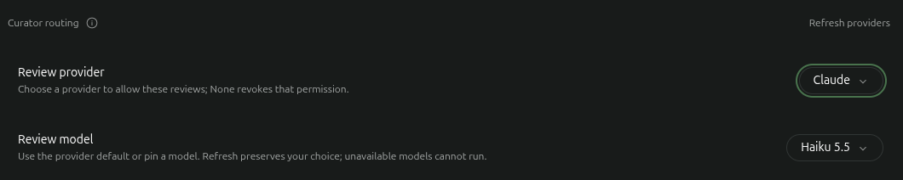
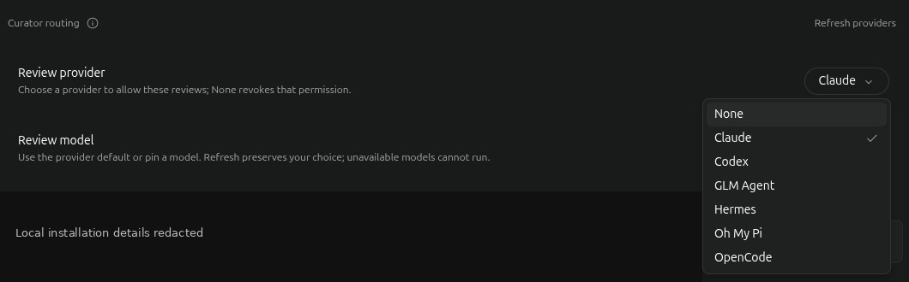

# Paseo Curator

Paseo agents often solve the same problems more than once: a brittle test command, an API quirk, a deployment check, or a debugging sequence that took several attempts to get right. Paseo Curator turns those verified lessons into reusable skills under `~/.agents/skills/`, where future agents can find them instead of rediscovering the same fix in a new session.

It brings Hermes-style automatic skill learning to the Paseo daemon, so learning is not tied to one foreground agent or session. It does **not** create a new skill after every turn. The plugin waits until a source agent has accumulated 10 unique tool calls across completed turns, then reviews the completed turn for a lesson that is both reusable and proven to work. A review that finds no durable lesson ends with `nothing_to_save`. When there is something worth keeping, the curator prefers to update a relevant existing skill and creates a new one only when no existing skill fits.

For example, it can preserve:

- a corrected command or setup step that fixed a recurring failure;
- a reliable debugging workflow that produced a verified result;
- a project or tool constraint that an existing skill omitted;
- a repeatable sequence that should become a checklist or helper script.

The curator submits structured requests through `submit_review`, such as "create this skill," "replace this exact text," or "remove this support file." The plugin checks paths, provenance, pre-review file versions, operation limits, and rollback safety before applying them. User-owned skills can be patched and their support files removed. Only archival is restricted to curator-created skills.

## Requirements

- Paseo daemon and app with the APIs used by SDK `0.16.0-beta.2`; manifest range `>=0.16.0-beta.2`. Future breaking releases are not guaranteed compatible. Native screenshots were checked on Linux with `0.17.0-beta.1`; macOS and Windows were not checked.
- Node.js **22.13.0 or later** (`node:sqlite` without an experimental flag), plus npm on the daemon PATH for Git preparation.
- An enabled, ready provider with working credentials, selected-model access, its required CLI/runtime, and live session support for MCP servers and tool invocations. Each background review consumes provider quota and may incur usage costs. Readiness alone does not verify account/model access.

Reviews preserve the exact source provider/model when available. All enabled, ready providers from the live host SDK catalog can be selected, including custom families. The reviewer uses the provider's normal tool permissions and can execute native tools, including file writes and commands. Curator does not confine the reviewer or enforce read-only execution. The prompt's no-write guidance is an instruction, not an enforced boundary. See [routing behavior and verification](docs/routing.md).

## Native screenshots

These are real Paseo `0.17.0-beta.1` Linux captures of Curator's current settings, cropped to the plugin. The expanded menu has a marked redaction over local installation details. No project prompts, transcripts or credentials are included. The saved Claude/Haiku choice is an example of existing settings, not a requirement or the default.





See [screenshot provenance and missing activity evidence](docs/screenshots/README.md) and the concise [public listing overview](OVERVIEW.md).

## Install

### From GitHub

```bash
paseo plugin install git:vicpon/paseo-curator
paseo plugin enable curator
paseo plugin reload curator
```

Verify that the daemon loaded it:

```bash
paseo plugin ls curator --json
paseo plugin logs curator --json
```

The plugin entry should show `"enabled": true` and `"status": "running"`. The logs should end with `Plugin ready`.

To update or remove it later:

```bash
paseo plugin update curator
paseo plugin reload curator

# Disable without deleting its state:
paseo plugin disable curator

# Remove the plugin registration:
paseo plugin remove curator
```

### From a local checkout

Use this when developing or testing an unpublished change:

```bash
git clone https://github.com/vicpon/paseo-curator.git
cd paseo-curator
npm ci
npm test
npm run typecheck
paseo plugin install "$PWD"
paseo plugin enable curator
paseo plugin reload curator
paseo plugin ls curator --json
```

The plugin runs its learning pipeline on the server and adds a compact timeline activity line. Paseo plugins are trusted and unsandboxed. Review the code before installing it: this plugin is intentionally allowed to update the configured skill library.

## Configuration

In Settings → Plugins → Curator, **Review provider** offers all enabled, ready providers from the host's catalog. **None** (default) disables fallback, not reviews on the source route. Selecting a provider explicitly authorizes transmission to that provider when the exact source route cannot run. **Review model** can follow that provider's default or pin a model. The screen discloses what is sent; refresh preserves both saved selections without saving. Host-disabled and unavailable providers are hidden, including their model controls. A saved inactive choice uses a generic placeholder without substitution.

Provider and model consent are read fresh before session creation, before sending the source excerpt, and while submitting/applying operations. Clearing, changing, invalidating, or failing to read settings prevents subsequent guarded work on that alternative route; data already transmitted cannot be recalled. When available, the settings revision fences out a prior consent even if the same selection is later restored. Version 1's explicit Codex selection migrates unchanged; invalid legacy values become None. New provider IDs are stored without a fixed provider enum or family eligibility policy.

Other values remain built in:

| Setting | Default |
|---|---:|
| Skill root | `~/.agents/skills/` |
| State database | `~/.paseo/plugins/curator/curator.sqlite` |
| Review cadence | 10 unique tool calls across completed turns |
| Curator provider | Exact source route when available; explicit fallback only |
| Reviewer tool permissions | Provider normal/default configuration; native tools can execute |
| Curator concurrency | 1 |
| Maximum operations per review | 20 |
| Maximum retries | 3 |
| Mark curator-created skills stale | 14 inactive days |
| Archive curator-created skills | 30 inactive days |
| Consolidation | Disabled |

Overrides for the built-in values require a source change and plugin reload. Fallback never selects another provider automatically. If no permitted route exists, the attempt raises `source-model-unavailable`, retries within the existing budget, and eventually fails with a timeline notice. This is not a successful skip or a `nothing_to_save` verdict.

Normal provider permissions can require human approval. Curator never auto-approves requests. A reviewer returning a permission stop or reaching its five-minute timeout is archived; its submission binding is revoked and in-flight callbacks settle before the attempt ends. Ready status does not prove account/model access. Fallback still requires an enumerated model because the SDK requires a `provider/model` selection; repeated model-discovery errors prevent a send even though the provider remains selectable.

Durable state includes cadence counters, queue claims and retries, reconciliation cursor, skill telemetry, and a content-free audit log. Migration preserves existing `nothing_to_save` outcomes and future exact outcomes, but cannot reconstruct no-op records that older versions already discarded or rewrote. Applied-batch intents and receipts live under `.paseo-curator/` inside the skill root.

## What is sent to providers

The curator prompt contains a bounded excerpt of one completed source turn plus an index of the shared skill library containing names, descriptions and SKILL.md hashes. It can include user and assistant messages, reasoning, tool calls and output, file contents, credentials, secrets, and personal information already present in that turn. The size bounds do not redact sensitive data, and there is no no-credentials or no-file-contents guarantee.

Every review route also receives exact captured skill-file text, bounded to 120,000 serialized characters. Hidden paths and common binary indicators are omitted; this is not secret detection or redaction. These files support exact-text corrections within the same review.

The background agent runs in the source workspace. Native tools can read or change workspace and skill files and execute commands, subject to that provider's normal permissions. Tool results can be sent to the selected provider too. The provider configured for the selected route receives the prompt and tool results under its own data policy and your account settings. The plugin is trusted, unsandboxed daemon code with the daemon user's filesystem and network access.

## How it triggers

1. Complete normal work in a Paseo agent.
2. The plugin accumulates unique tool-call iterations for that source agent.
3. At 10 accumulated iterations, it queues the completed turn for review.
4. The plugin opens a reviewer without sending the excerpt, attaches its identity-bound `submit_review` tool, and checks the actual session capabilities.
5. The reviewer explicitly submits `nothing_to_save` or a batch of operations. Validation feedback returns to that same running reviewer for correction.
6. A successful accepted tool result records the durable outcome. Final assistant prose is ignored.

## Review submission protocol

`submit_review` accepts exactly `summary`, `outcome` and `operations`. A `saved` outcome requires 1–20 operations; `nothing_to_save` requires an empty array. Reviews cannot archive skills. The existing guarded manager remains the only plugin mutation path.

Completed source excerpts are now captured durably at enqueue (bounded to 100 captures, expiring after 24 hours, deleted on terminal outcome). Review uses the exact captured source turn when provider history loses daemon turn IDs. Schema feedback explicitly explains native operation arrays and same-run repair. See [reliability, privacy/deletion and UAT details](docs/review-reliability.md).

Schema, exact-text and manager validation errors return bounded, value-free feedback through the tool to the same running reviewer. The reviewer has four submission calls within a five-minute submission window to correct its arguments. There is no final-answer JSON parser and no freeform JSON fallback. The provider execution wait is separately capped at five minutes after discovery/session creation; discovery and creation can add time. Activity notifications wait at most one second; authorization lookups wait at most ten seconds each. Finishing without a successful submission fails with `missing successful review submission` (or the specific bounded submission error); an unavailable registration or session capability fails with `structured-tool-injection-unavailable` before the source excerpt is sent. An explicitly consented alternative can be tried if the source session cannot provide the tool.

The host supplies the calling agent identity. The plugin binds it to the exact reviewer, source turn, queue ID and claim attempt; model arguments cannot choose that authority. Source agents, marker-spoofed agents, closed/replayed bindings, expired claims and revoked alternative routes cannot submit. Authorization and current-claim checks run again under locks and during apply. Duplicate accepted submissions return the original result and never apply twice; different submissions after acceptance are rejected.

The callback applies through the manager, writes its durable receipt, then commits the queue outcome and audit together before returning success. Accepted work remains recorded if final prose is malformed or the provider later errors. If a failure occurs between the filesystem receipt and SQLite completion, reconciliation uses that receipt before any rerun, including on the last attempt. Distinct rejected batches and rollback-failure reasons retain separate immutable audits. Failed rollback records a rejection and requires reconciliation; it cannot be repaired by another model submission. This version does not replay terminal failed production reviews.

Tests include the real pinned Paseo host hook/tool runtime as a development dependency, exercising registration, JSON Schema serialization, host parsing, feedback and invocation with isolated SQLite/files. A scripted provider transport in those tests does not prove live inference; live probes must be reported separately.

## What you see in Paseo

The curator stays quiet when a review finds nothing reusable. It does not add a “no reusable lesson found” message to your timeline. Timeline notices do not survive a daemon restart; audit outcomes remain in SQLite.

When a review makes a real change, a single muted subtext line appears in the source agent's timeline — **Self-improvement review — updated \<skills\>** — listing the affected skill names (and change count when more than one). If a review exhausts its retries or reaches a terminal safety failure, a compact danger-colored line — **Curator review failed** — appears instead. These notices are appended only after the durable queue state has been updated; notification failure cannot change the review outcome.

Use these commands while testing:

```bash
paseo plugin logs curator --json
paseo ls --json
```

To inspect the latest durable outcomes without requiring the `sqlite3` CLI:

```bash
node - <<'NODE'
const { DatabaseSync } = require("node:sqlite");
const db = new DatabaseSync(
  process.env.HOME + "/.paseo/plugins/curator/curator.sqlite",
  { readOnly: true },
);

console.table(db.prepare(`
  SELECT source_agent_id, turn_id, status, attempts, completed_at, error
  FROM queue
  ORDER BY created_at DESC
  LIMIT 10
`).all());

console.table(db.prepare(`
  SELECT source_agent_id, turn_id, outcome, operation_count,
         skill_names_json, rejection_reason, created_at
  FROM audit_log
  ORDER BY id DESC
  LIMIT 10
`).all());
NODE
```

A successful review ends with queue status `nothing_to_save` or `applied`. An `applied` row with a positive `operation_count` should correspond to a created or patched skill under `~/.agents/skills/`.

## Safety and recovery

- Tool arguments are untrusted structured data. Validation applies only to plugin-applied structured operations; the reviewing agent can execute native tools under the provider's normal permissions. These validation checks apply to structured proposals, not direct native tool actions.
- The plugin captures byte-exact skill versions before review, then compares touched skills under its locks before any mutation, including `remove_file`. Model-supplied read sets, hashes and identity/claim fields are rejected; the plugin owns the snapshot and authority. Changes after capture reject the batch. These locks coordinate plugin batches, not arbitrary external editors.
- Paths are contained within the canonical skill root; symlink swaps are checked again at mutation and rollback time.
- Batches use stable locks, snapshots, atomic file writes, and rollback.
- A pre-mutation intent journal reconciles crashes between filesystem commit and SQLite queue completion without rerunning nondeterministic curator output.
- Queue claims use attempt-generation fencing; stale attempts cannot complete newer claims and are checked during filesystem application.
- Timeline reset, gap, stale cursor, epoch changes, and non-progressing pagination are rejected.
- Curator agents are excluded from their own lifecycle. Agent IDs include the route and queue attempt. A retry starts a fresh review against its new pre-review capture; it cannot reattach to output based on an earlier capture. Curator adds no permission-denial hook and does not alter ordinary source-agent permissions.
- Source-turn entries and skill-index descriptions are explicitly delimited as untrusted data; curator agents are instructed never to execute quoted commands or tasks.
- Automatic maintenance archives only skills whose frontmatter says `created_by: paseo-curator`. User and externally installed skills are protected from archival, but reviews can patch them or remove their support files.
- Errors and audits use fixed summaries and bounded failure categories rather than raw transcripts or model output. Audits include source identifiers, skill names, operation counts and hashes. This does not control Paseo or provider retention of agent history, or prevent sensitive content being present in generated skill files.

Provider eligibility and native confinement checks were removed at the user's explicit request. Registry reviewers may reject this safety posture. The structured operation safeguards do not prevent a reviewer from changing files directly through native tools. Existing rollback snapshots store UTF-8 text, so rollback restoration of binary assets is not byte-preserving; version checks compare raw bytes.

## Recovery behavior

When the first lifecycle hook supplies the Paseo API after plugin load, the plugin:

1. recovers stale `running` queue rows;
2. reconciles durable filesystem intents/receipts before any curator rerun;
3. drains pending work;
4. scans a bounded set of recent idle-agent timeline tails to recover missed live hooks;
5. runs deterministic maintenance when enabled.

Ambiguous mixed filesystem state and failed rollback are terminalized as reconciliation-required rather than replayed automatically.

## Attribution

The review methodology is adapted from Hermes by Nous Research under the MIT License. See [NOTICE](NOTICE) and [LICENSE](LICENSE).
